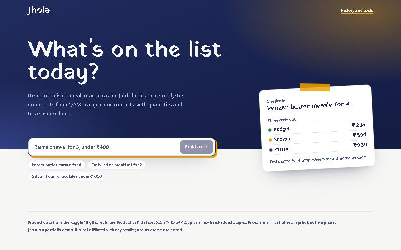
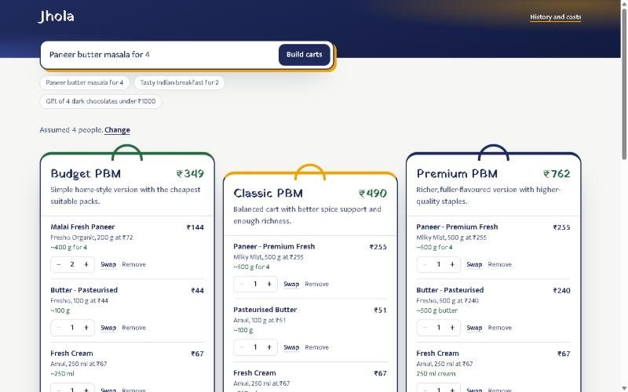
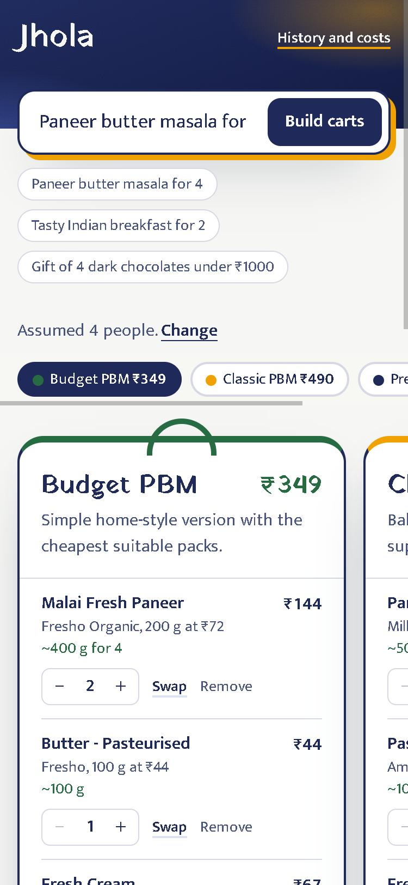
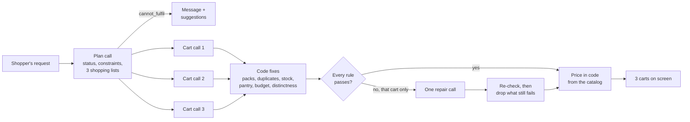

# AI Cart Builder (Jhola)

Type any grocery request in plain language ("paneer butter masala for 4") and get 3 different, ready-to-order carts built from 1,008 real Indian grocery products.

The LLM only picks product IDs and quantities. Code checks every pick and does all the pricing, so the app never shows an invented product or price.

**Live demo:** _coming soon_

| Ask in one line | Get three carts to compare | Works on a phone |
| --- | --- | --- |
|  |  |  |

Built as a portfolio project. The full product spec is in [SPEC.md](SPEC.md).

## How it works

1. **Plan** (1 LLM call): decide the status, assumptions, constraints (budget, item count) and 3 different carts, each as a plain shopping list ("paneer 400 g; tomato 500 g; …").
2. **Carts** (3 LLM calls in parallel): map each shopping list to catalog product IDs and say how much of each is needed (e.g. 400 g). With a budget, each cart gets its own spend limit (about 60%, 80% and 92% of the budget).
3. **Code does the maths and fixes what it can, instantly:**
   - pack counts come from the amount needed (400 g of 200 g packs = 2 packs), not from the model;
   - the same product listed twice becomes one line, and an out-of-stock pick swaps to its closest in-stock twin;
   - pantry staples (salt, oil, turmeric…) become optional;
   - an over-budget cart swaps to cheaper packs of the same kind;
   - two carts that are too alike swap shared items for other brands.
4. **Validate** every rule (real IDs, in stock, qty 1–10, budget, item count, carts not too similar). Only a cart that still breaks a rule gets one repair call, with code's prices shown to the model.
5. **Price** in code from the catalog. The model never sets a price or total.

No call uses the model's "thinking" mode, except a repair that has to fix a budget or item count. Evals showed thinking added 2–5 s per call without better carts, because code already does the parts that need care. Each cart call writes a third of the output and all three run at once, and every call shares the same cached prompt prefix (rules + catalog), which keeps cost low.



## Key decisions

- **The model picks, code counts.** The LLM returns product IDs and how much of each is needed; code computes packs, prices and totals from the catalog. A wrong or invented price can't reach the screen, and the schema plus ID checks mean a prompt-injection reply can't put arbitrary content in a cart.
- **The whole catalog goes in the prompt.** At about 1,000 products it is roughly 21k tokens, and OpenAI's prompt caching bills about 95% of it at the cached rate, so a query costs about $0.02. Search or embeddings only become worth it when the catalog stops fitting.
- **One plan, three parallel carts, instead of one big call.** Each call writes a third of the output and they run at once, which roughly halved latency against a single call.
- **Mechanical fixes live in code, not in repair prompts.** Duplicate lines, out-of-stock picks, pantry staples, budgets and near-identical carts are fixed deterministically and unit-tested. Only what code can't fix goes back to the model.
- **Limits ship with the public link.** 10 requests per person per hour and 300 a day, counted in Upstash Redis so they hold across serverless instances, plus a 24-hour cache for repeated questions.

## Known limitations

- Prices are a past snapshot, and about 50 everyday items (fresh fruit and vegetables, some dark chocolates) were added by hand with illustrative prices because the dataset lacks them.
- Stock is simulated: about 4% of products are marked out of stock so substitutions show up.
- Amounts are the model's judgement. Code makes the pack counts match the amounts, but a plan can still ask for more of something than a cook would (for example a large butter pack in a "premium" cart).
- One catalog, one store, no login, and checkout is a demo: nothing is ordered or charged.
- Latency depends on OpenAI's load; it ranged from about 4 s to 9 s for the same queries on the same day.

## Evaluation

`npm run eval` runs 30 queries through the real pipeline: 10 recipes, 8 meal ideas, 7 budget or gift requests and 5 edge cases (unavailable ingredients, a non-grocery request, a one-word query, a 261-character query and a prompt-injection attempt). Each query has its own checks in [evals/queries.json](evals/queries.json), and results are saved to [evals/results/](evals/results/).

Latest run (gpt-5.4-mini, 1,008 products, queries run one at a time from a home connection in India):

| Metric | How it's measured | Result | Target |
| --- | --- | --- | --- |
| Valid on first try | Passes every rule with no repair call | 97% | report |
| Valid after repair | Passes every rule after at most one repair | **100%** | ≥ 90% |
| Constraints met | Budget and item-count rules hold in all 3 carts | **100%** | ≥ 90% |
| Ingredient coverage | Share of required ingredient groups found in each cart | **99%** | ≥ 90% |
| Variant distinctness | Mean pairwise Jaccard on product IDs (lower = more different) | **0.27** | < 0.60 |
| Correct status | Edge cases get the expected status | **5 of 5** | 5 of 5 |
| Latency | p50 / p95 per query | 6.2 s / 8.4 s | p95 < 8 s |
| Cost | Average per query, from token counts and OpenAI list prices | $0.019 (about ₹1.6) | report |

Latency is the one target this run misses, by 0.4 s. It swings with OpenAI's load: the previous run, with nearly the same code, measured 4.3 s / 5.4 s. These runs also cross from India to OpenAI's US servers for each of the 2–3 back-to-back calls; the deployed app runs in the US, next to OpenAI.

### What each change improved

Each row is one full 30-query run after a change. Results move by a query or two between runs, so a single run's changes are signals, not proof.

| Change | First try | After repair | Constraints | Edge | p50 / p95 | Cost |
| --- | --- | --- | --- | --- | --- | --- |
| Baseline: plan + 3 parallel carts, 980 products | 80% | 83% | 86% | 4/5 | 6.2 / 12.4 s | $0.020 |
| Own groups for each dish masala and green tea; "packaging isn't a missing item"; plan without thinking | 83% | 100% | 100% | 5/5 | 5.8 / 11.9 s | $0.017 |
| Repairs without thinking; carts told to stay true to their tier | 90% | 93% | 86% | 5/5 | 5.9 / 7.3 s | $0.016 |
| Repairs think only for budget/count fixes; clearer "N different X" counts | 90% | 90% | 100% | 4/5 | 6.1 / 8.2 s | $0.018 |
| Code makes too-similar carts distinct; vague-query rule | 90% | 93% | 100% | 4/5 | 5.8 / 10.5 s | $0.018 |
| Code merges duplicate lines and replaces out-of-stock picks; narrower vague rule | 93% | 97% | 100% | 5/5 | 6.0 / 8.7 s | $0.017 |
| Each cart gets its own spend limit when there's a budget | 93% | 97% | 100% | 4/5 | 5.5 / 7.3 s | $0.016 |
| Explicit "not a shopping request → cannot_fulfil" rule | 97% | 100% | 100% | 5/5 | 4.3 / 5.4 s | $0.017 |
| Code computes pack counts from the amount needed; amount hints for butter, cream and oil | 97% | 100% | 100% | 5/5 | 6.2 / 8.4 s | $0.019 |

The biggest wins came from moving mechanical fixes (duplicates, budgets, near-identical carts) out of the model and into code: they're instant, deterministic and testable, and they cut repair calls from 5 of 30 (second run) to 1 of 30. Latency also depends on OpenAI's load at the time; the same query took 5–6 s in the morning and 8–15 s in the afternoon of the same day.

## Run locally

```bash
npm install
cp .env.example .env   # then add your OPENAI_API_KEY
npm run dev
```

Other commands:

```bash
npm test                          # unit tests (no API calls)
npm run eval                      # run the 30-query eval (about 5 min, about $0.50)
npm run eval -- --group=edge      # one group only
npm run try                       # run the 3 example queries against the real model
npm run try -- "poha for 3"       # run your own query
DEBUG_CARTS=1 npm run try         # also print which rules triggered a repair
npm run catalog:build             # rebuild data/catalog.json from data/raw/bigbasket.csv
npm run catalog:check             # check the catalog covers the promised dishes
npm run check:contrast            # check every UI colour pair against WCAG AA
```

## Data

Product data comes from the Kaggle "BigBasket Entire Product List" dataset (CC BY-NC-SA 4.0), plus about 50 hand-added staples (fresh fruit and vegetables, a few dark chocolates and everyday items the dataset lacks) whose prices are illustrative. It is used for non-commercial purposes, and prices are a past snapshot. This project is not affiliated with any retailer.
